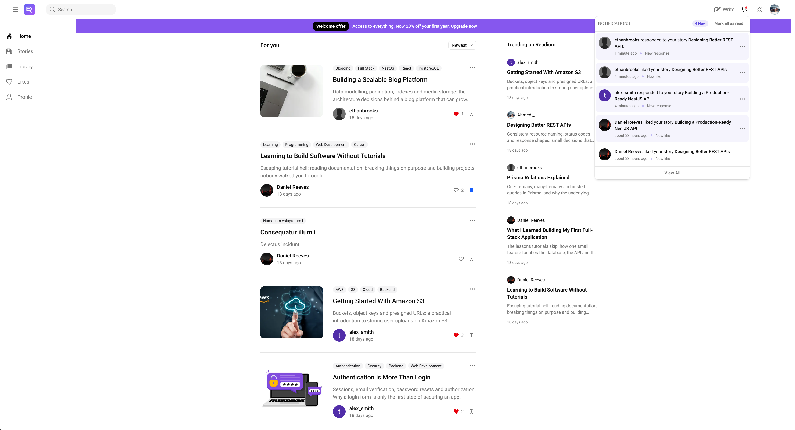
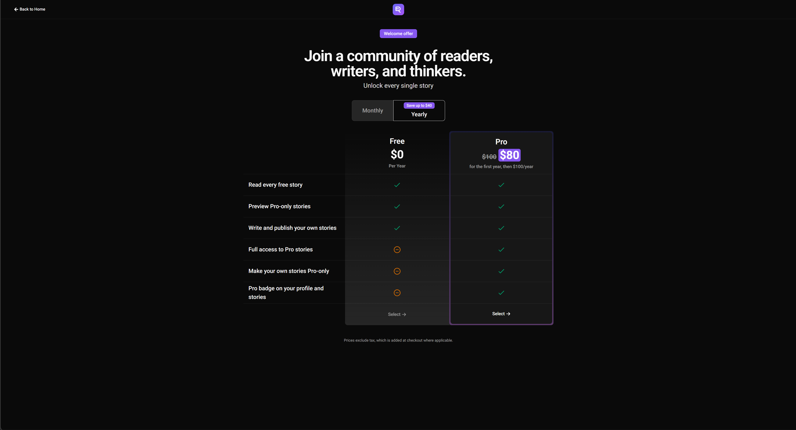
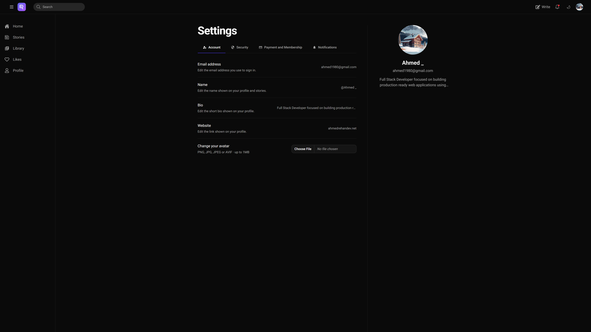

# Readium :bookmark_tabs:

**A Full-stack publishing platform for writers and readers, inspired by Medium.**

Readium lets writers publish free or Pro-only stories, and readers discover, like, bookmark and discuss them. Readers subscribe through Stripe to unlock every Pro story, get real-time notifications as people interact with their work, and moderators keep the community clean from an admin dashboard. It is built as a TypeScript monorepo with a Next.js frontend and a NestJS API.

> [!NOTE]
> **Live demo:** [readium.ahmedrehandev.net](https://readium.ahmedrehandev.net)
>
> - **Cold starts:** the app is deployed on **Render's free tier**, which spins the server down when idle. The first request after a while can take **about 60 seconds** while it wakes up. After that, it's fast.
> - **Sandbox payments:** subscriptions run in **Stripe's sandbox (test mode)**, so no real money is charged. Use the test card `4242 4242 4242 4242` with any future expiry date and any CVC.

## :camera_flash: Screenshots



|                             Plans                             |                        Settings                        |
| :-----------------------------------------------------------: | :----------------------------------------------------: |
|  |  |

## :bookmark: Features

### Reading and discovery

- Home feed with sorting, plus a **Trending** panel
- Global search across stories and writers
- Public author profiles at `/@username`
- **Pro-only stories:** non-members get a preview, Pro members read in full
- Share stories to social platforms or copy the link

### Writing

- Rich-text editor (Tiptap) with syntax-highlighted code blocks
- Cover image uploads to AWS S3
- Drafts and publishing, tags and slug-based URLs
- A **Free / Pro-only** toggle on each story for Pro members
- A dashboard to manage published stories and drafts

### Community

- Likes, bookmarks and comments
- A personal **Library** of liked, bookmarked and commented stories
- Content reporting: spam, harassment, rules violations and AI-generated content

### Notifications

- **Real-time** in-app notifications over WebSockets (Socket.io) for likes, comments and bookmarks
- A full notifications page
- Transactional emails with Resend and React Email: email verification and changes, two-factor codes, subscription welcome and cancellation, report confirmations, moderation warnings and bans

### Authentication and security

- Email and password sign-up with email verification and password reset
- OAuth sign-in with **Google, GitHub and Twitch**
- **Two-factor authentication** (TOTP authenticator apps with a QR code, plus backup codes)
- Cookie-based sessions and role-based access control (members and admins)
- Account bans, and rate limiting on both the API and the auth routes

### Subscriptions

- **Pro membership** through Stripe Checkout, billed monthly or yearly
- A **welcome offer** for members who never subscribed: 20% off the first year, shown on the homepage and the plans page
- Plan and billing management through the Stripe customer portal

### Admin dashboard

- Analytics overview of users, stories, reports and revenue
- User management, including bans
- Story moderation and a report review queue
- Payments overview and a shared real-time notifications room for admins

### SEO

- Per-page metadata, Open Graph images, canonical URLs and `robots.txt`

## :toolbox: Tech Stack

| Layer          | Technologies                                                                                                                               |
| -------------- | ------------------------------------------------------------------------------------------------------------------------------------------ |
| **Monorepo**   | Turborepo, pnpm workspaces, TypeScript                                                                                                     |
| **Frontend**   | Next.js 16 (App Router), React 19, Tailwind CSS 4, shadcn/ui, TanStack Query, React Hook Form, Zod, nuqs, Tiptap, Motion, Socket.io client |
| **Backend**    | NestJS, Prisma 7, Neon (PostgreSQL), Better Auth, Socket.io, class-validator                                                               |
| **Payments**   | Stripe                                                                                                                                     |
| **Email**      | Resend, React Email                                                                                                                        |
| **Storage**    | AWS S3                                                                                                                                     |
| **Testing**    | Jest                                                                                                                                       |
| **Deployment** | Render, Vercel                                                                                                                             |

### Project structure

```
readium/
├── apps/
│   ├── web/        # Next.js frontend (port 3000)
│   └── backend/    # NestJS API, Prisma and Better Auth (port 3001)
└── packages/
    ├── types/      # Shared API response types
    ├── constants/  # Shared constants
    ├── assets/     # Shared images and logos
    ├── eslint-config/
    └── typescript-config/
```

## :page_facing_up: Getting Started

### Prerequisites

- **Node.js 20.19+** (developed on Node 24)
- **pnpm 11**
- A **PostgreSQL** database (the project uses [Neon](https://neon.tech))
- A **Stripe** account in test mode, and the [Stripe CLI](https://docs.stripe.com/stripe-cli) for local webhooks
- A **Resend** account and an **AWS S3** bucket
- _Optional:_ OAuth apps for Google, GitHub and Twitch

### Installation

1. **Clone the repository and install dependencies**

   ```bash
   git clone https://github.com/Ahmed-HA-RE/readium.git
   cd readium
   pnpm install
   ```

2. **Set up the environment variables**

   The root [`.env.example`](.env.example) has two commented sections, **Backend** and **Frontend**. Each app reads its own file, so copy each section into its app and fill in the values:

   ```bash
   # Backend section  →  apps/backend/.env
   # Frontend section →  apps/web/.env
   ```

   See [Environment variables](#label-environment-variables) below for what each one does.

3. **Set up the database**

   ```bash
   pnpm --filter backend exec prisma generate
   pnpm --filter backend exec prisma migrate deploy
   ```

4. **Forward Stripe webhooks** (in a separate terminal)

   ```bash
   stripe listen --forward-to localhost:3001/api/auth/stripe/webhook
   ```

   Copy the `whsec_...` signing secret it prints into `STRIPE_WEBHOOK_SECRET_DEV` in `apps/backend/.env`.

5. **Start the apps**

   ```bash
   pnpm turbo dev
   ```

   The frontend runs on [http://localhost:3000](http://localhost:3000) and the API on [http://localhost:3001](http://localhost:3001).

### Scripts

| Command                      | What it does                                                        |
| ---------------------------- | ------------------------------------------------------------------- |
| `pnpm turbo dev`             | Runs the frontend and the backend in watch mode                     |
| `pnpm turbo build`           | Builds every app (the backend build also applies Prisma migrations) |
| `pnpm turbo lint`            | Lints every app                                                     |
| `pnpm turbo check-types`     | Type-checks every app                                               |
| `pnpm --filter backend test` | Runs the backend unit tests                                         |

## :label: Environment Variables

### Backend (`apps/backend/.env`)

| Variable                                     | Description                                                        |
| -------------------------------------------- | ------------------------------------------------------------------ |
| `PORT`                                       | Port the API listens on (`3001` locally)                           |
| `NODE_ENV`                                   | `development` or `production`                                      |
| `DATABASE_URL`                               | PostgreSQL connection string                                       |
| `BETTER_AUTH_SECRET`                         | Secret used to sign sessions; a long random string                 |
| `BETTER_AUTH_URL`                            | Public URL of the backend                                          |
| `COOKIE_DOMAIN`                              | Shared cookie domain in production; leave empty locally            |
| `GITHUB_CLIENT_ID`, `GITHUB_CLIENT_SECRET`   | GitHub OAuth app credentials                                       |
| `GOOGLE_CLIENT_ID`, `GOOGLE_CLIENT_SECRET`   | Google OAuth app credentials                                       |
| `TWITCH_CLIENT_ID`, `TWITCH_CLIENT_SECRET`   | Twitch OAuth app credentials                                       |
| `APP_BACKEND_URL`, `APP_FRONTEND_URL`        | App origins, used for CORS, Socket.io and email links              |
| `RESEND_API_KEY`                             | Resend API key                                                     |
| `EMAIL_DOMAIN`                               | Verified sending domain; emails come from `noreply@<EMAIL_DOMAIN>` |
| `AWS_ACCESS_KEY_ID`, `AWS_SECRET_ACCESS_KEY` | AWS credentials for S3 uploads                                     |
| `AWS_REGION`, `AWS_BUCKET_NAME`              | Region and name of the S3 bucket                                   |
| `STRIPE_SECRET_KEY`                          | Stripe secret key (`sk_test_...` locally)                          |
| `STRIPE_WEBHOOK_SECRET`                      | Signing secret of the Stripe dashboard webhook (production)        |
| `STRIPE_WEBHOOK_SECRET_DEV`                  | Signing secret printed by `stripe listen` (development)            |
| `STRIPE_COUPON_ID_20`                        | ID of the 20% welcome-offer coupon                                 |
| `PRO_PLAN_NAME`                              | Name of the Pro plan                                               |
| `PRO_PLAN_PRICE_ID`                          | Stripe price ID of the monthly Pro plan                            |
| `PRO_ANNUAL_DISCOUNT_PRICE_ID`               | Stripe price ID of the yearly Pro plan                             |

### Frontend (`apps/web/.env`)

| Variable                      | Description                                                 |
| ----------------------------- | ----------------------------------------------------------- |
| `NEXT_PUBLIC_SITE_URL`        | Public URL of the frontend                                  |
| `NEXT_PUBLIC_API_URL`         | NestJS API base URL, ending in `/api`                       |
| `NEXT_PUBLIC_BETTER_AUTH_URL` | Better Auth URL on the backend, ending in `/api/auth`       |
| `NEXT_PUBLIC_SOCKET_URL`      | Backend origin with no path, for Socket.io                  |
| `NEXT_PUBLIC_STRIPE_LIVE_URL` | Stripe dashboard link used by the admin pages in production |
| `NEXT_PUBLIC_STRIPE_TEST_URL` | Stripe sandbox dashboard link used everywhere else          |

## :scroll: Purpose and Inspiration

**Inspiration.** Readium is inspired by [Medium](https://medium.com). Medium's layout and user experience served as the baseline, not a pixel-perfect target: Readium makes its own decisions where they made sense, such as Pro-only stories, the welcome offer and its moderation flow.

**Purpose.** The goal was to build a large, real-world product end to end, and to do it with an **AI-assisted, spec-driven workflow**. Each feature started as a written spec and plan, was built on its own branch with [Claude Code](https://claude.com/claude-code) as the pair programmer, and every change was reviewed before merging. I owned the architecture, the specs and the product decisions. The project was as much about learning how to lead that workflow as about the app itself.

## :ledger: License

© 2026 Ahmed Haitham. All rights reserved.
