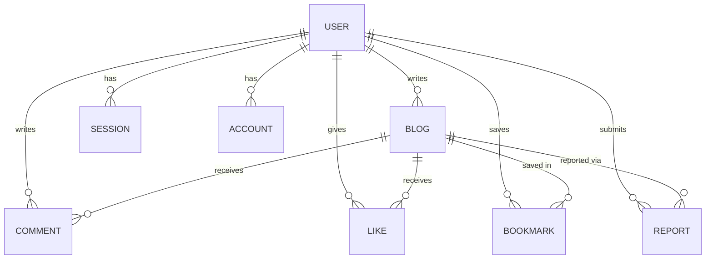
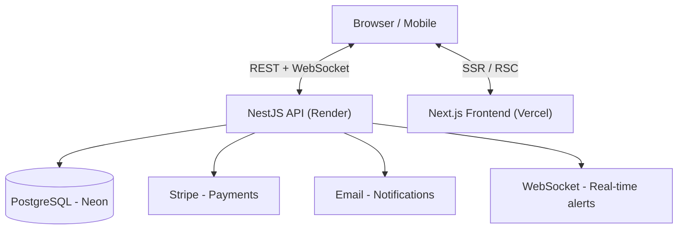
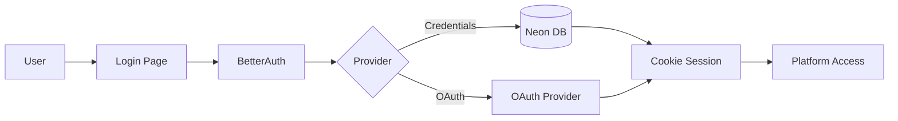
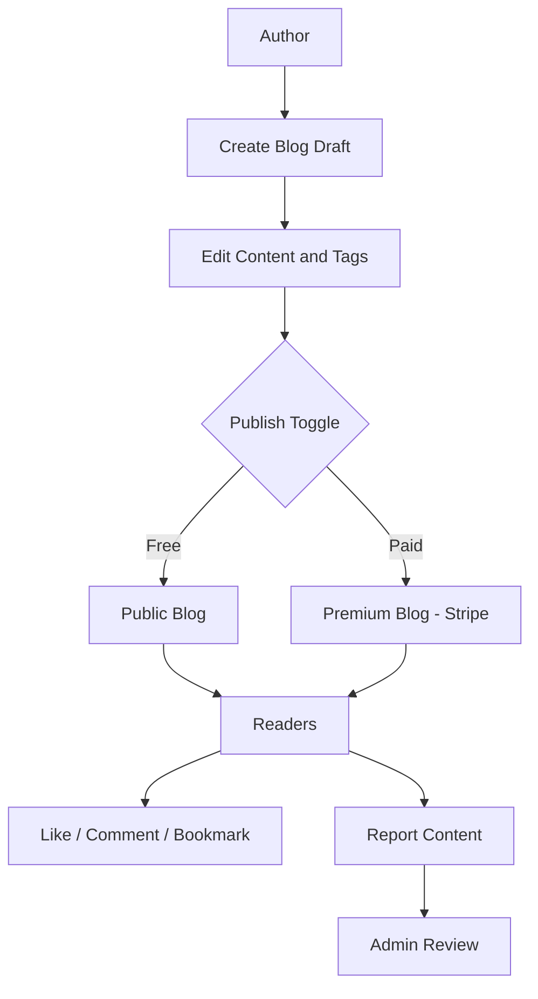

# Readium 📖
> **An accessible publishing platform where authors share knowledge and readers discover valuable content.**

---

## Problem

Traditional publishing platforms create barriers for independent writers:

| Pain Point | Impact |
|---|---|
| High platform fees | Makes publishing inaccessible for new authors |
| Monetization restrictions | Limits how authors earn from their content |
| Complex publishing workflows | Discourages knowledge sharing |

**Readium removes these barriers** — giving authors full control over how they publish, whether free or paid.

---

## Who Is Readium For

| Persona | Use Case |
|---|---|
| **Developers** | Share code, dev practices, technical solutions, and workflows |
| **Content creators** | Publish knowledge, experiences, and expertise |
| **Professionals** | Document what they know and help others learn |
| **Learners** | Share insights and practical lessons |

**Content examples:** AI implementation, React best practices, Prisma workflows, software architecture, order tracking systems, dev tutorials — anything that provides **practical value** to readers.

> Readium is built around **knowledge sharing and meaningful content**, not low-value noise.

---

## Key Features

### Content & Publishing
- Authors create, edit, and publish blogs with a toggle for free or paid access
- Draft/publish status control before going live
- Tag-based organization and slug-based URLs

### Reader Interaction
- Likes, bookmarks, and comments on blogs
- Community discussion and engagement

### Privacy & Security
- Role-Based Access Control (RBAC) for users, authors, and admins
- Cookie-based session authentication
- Content reporting system (spam, harassment, violations, AI-generated)
- Rate limiting against bot attacks

### Admin Dashboard
- Full platform management — users, blogs, reports
- Analytics overview: user, blog, reports, and revenue cards

### User Management
- Profile management — bio, website, avatar
- Password and account settings control
- View personal blogs, likes, comments, bookmarks
- Subscription and billing management via Stripe portal

### Notifications
- Email notifications for verification, subscription updates, account activity
- Real-time alerts for comments, likes, bookmarks via NestJS WebSocket integration

### Performance
- Paginated results, optimized queries, filtering and indexing
- Google Search Console integration for SEO monitoring
- Rate limiting for bot protection

---

## Data Model

```prisma
enum ReportReason {
  SPAM
  RULES_VIOLATION
  HARASSMENT
  AI_GENERATED
}

enum ReportStatus {
  PENDING
  RESOLVED
  REJECTED
}

model User {
  id            String    @id
  name          String    @unique
  email         String    @unique
  emailVerified Boolean   @default(false)
  image         String?
  bio           String?
  website       String?
  role          String?
  banned        Boolean?  @default(false)
  banReason     String?
  banExpires    DateTime?
  createdAt     DateTime  @default(now())
  updatedAt     DateTime  @updatedAt

  sessions  Session[]
  accounts  Account[]
  blogs     Blog[]
  comments  Comment[]
  likes     Like[]
  bookmarks Bookmark[]
  reports   Report[]

  @@map("user")
}

model Blog {
  id          String   @id @default(uuid())
  title       String
  slug        String   @unique
  content     String
  tags        String[]
  coverImage  String?
  isPublished Boolean  @default(false)
  authorId    String
  author      User     @relation(fields: [authorId], references: [id], onDelete: Cascade)
  createdAt   DateTime @default(now())
  updatedAt   DateTime @updatedAt

  comments  Comment[]
  likes     Like[]
  bookmarks Bookmark[]
  report    Report[]

  @@index([authorId])
  @@index([isPublished])
  @@map("blog")
}

model Comment {
  id        String   @id @default(uuid())
  content   String
  authorId  String
  blogId    String
  createdAt DateTime @default(now())
  updatedAt DateTime @updatedAt

  author User @relation(fields: [authorId], references: [id], onDelete: Cascade)
  blog   Blog @relation(fields: [blogId], references: [id], onDelete: Cascade)

  @@index([authorId, blogId])
  @@map("comment")
}

model Like {
  id        String   @id @default(uuid())
  userId    String
  blogId    String
  createdAt DateTime @default(now())
  updatedAt DateTime @updatedAt

  user User @relation(fields: [userId], references: [id], onDelete: Cascade)
  blog Blog @relation(fields: [blogId], references: [id], onDelete: Cascade)

  @@unique([userId, blogId])
  @@map("like")
}

model Bookmark {
  id        String   @id @default(uuid())
  userId    String
  blogId    String
  createdAt DateTime @default(now())
  updatedAt DateTime @updatedAt

  user User @relation(fields: [userId], references: [id], onDelete: Cascade)
  blog Blog @relation(fields: [blogId], references: [id], onDelete: Cascade)

  @@unique([userId, blogId])
  @@map("bookmark")
}

model Report {
  id        String       @id @default(uuid())
  reason    ReportReason
  status    ReportStatus @default(PENDING)
  userId    String
  blogId    String
  createdAt DateTime     @default(now())
  updatedAt DateTime     @updatedAt

  user User @relation(fields: [userId], references: [id], onDelete: Cascade)
  blog Blog @relation(fields: [blogId], references: [id], onDelete: Cascade)

  @@unique([userId, blogId])
  @@map("report")
}
```

### Entity Relationships



---

## Architecture

### System Overview



### Auth Flow



### Content Publishing Flow



---

## Tech Stack

| Category | Technology |
|---|---|
| Language | TypeScript |
| Frontend | Next.js, React, Tailwind CSS, ShadCN, TanStack Query, TanStack Table |
| Backend | NestJS, Node.js |
| Database | PostgreSQL (Neon) |
| ORM | Prisma |
| Payments | Stripe |
| Real-time | NestJS WebSockets |
| Testing | Jest |
| Deployment | Vercel (frontend) · Render (backend) |
| Version Control | Git, GitHub |

---

## Monetization

Authors can charge readers for access to **premium blog content** through Stripe subscription integration:

```
Free tier    -> read free blogs, basic interaction
Premium tier -> access paid content from subscribed authors
Author tools -> set blog as free or paid, manage earnings
```

---

## UI / UX

Design inspired by **[Medium](https://medium.com)** — clean, minimal, content-first reading experience focused on typography and distraction-free reading.

---

## Status

> In development — monorepo architecture with Turborepo, NestJS backend, Next.js frontend.
